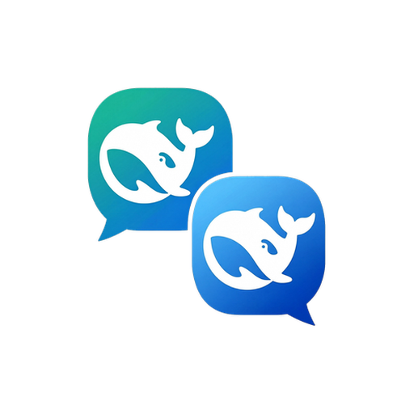

# Session Fleet

`dsh-plugin-session-fleet`

**Find the other sessions working in the same checkout, then agree on who touches what, without leaving the conversation.**

Several sessions can share one workspace. When two of them edit the same files or stage to the same Git index, one overwrites the other. Session Fleet gives an agent three things it otherwise lacks: a way to see which peers are active, a way to read what a peer already did, and a way to send one scoped proposal and wait for the answer.

If this plugin is useful to you, a ⭐ on [GitHub](https://github.com/Sivan757/dsh-plugin-session-fleet) is appreciated.

English | [简体中文](README.zh.md) | [npm](https://www.npmjs.com/package/dsh-plugin-session-fleet)

 

[Demo](#demo) · [Quick start](#quick-start) · [What it does](#what-it-does) · [Everyday use](#everyday-use) · [Compatibility](#compatibility) · [Configuration](#configuration) · [FAQ](#faq)

## Demo

A screen recording is being re-recorded against a scratch profile. Until it lands, the three steps below describe the flow.

1. **Ask who is working.** One question in an ordinary session.
2. **Read a compact answer.** The model calls `list_sessions` with a status and a time window, so it searches eleven rows instead of every session on the machine.
3. **Decide from evidence.** The answer names the peer, its working directory and the last time it moved, and it separates "running now" from "recently active". Subagent sessions stay out of the count.

## Quick start

1. In the DSH Web GUI, open **Plugins** in the sidebar.
2. Press **Add plugin**, type `dsh-plugin-session-fleet`, then install it.
3. Enable **Session Fleet** in the plugin list, then restart DSH.
4. In any session, ask _"which sessions are working in this checkout?"_ The agent now has the Fleet tools.

Terminal alternative: `dsh plugin --profile <name> add dsh-plugin-session-fleet`, then add the `tool-session-fleet` row through your profile patch. The plugin is opt-in: installing it does not mount the tools until the profile carries the row.

## What it does

### Discovery

`list_sessions` finds Host-visible sessions and returns only what a decision needs: identity, state, activity, directory and title. Filter with `status` (`running`/`idle`), `updated_within` (`30m`, `2h`, `1d`), `cwd`, a title `query`, or sort by `id`. Add `view: "compact"` and each session becomes one pipe-delimited line instead of a JSON object, which keeps a peer scan cheap.

`search_sessions` searches a durable local index over session logs and answers "where did I discuss X". The plugin owns and refreshes that index, so it works on a default installation where the Host index is disabled. Very recent turns can be missing; use `list_sessions` for titles and `inspect_session` for one session.

### Coordination

`send_to_session` delivers peer input through the native inbox. Besides plain text it accepts a structured object: `propose`, `accept`, `block`, `update`, `complete`, `handoff`, `release`. A proposal names one task, one owner, one to sixteen exact scopes and the decision it wants back. The receipt reports the delivery boundary, a stable message id, a revision, and whether persistence acknowledged the write. Admission is not agreement, and a repeated send is a new message.

`manage_session_inbox` reads pending peer input without starting the target, lets a sender revise its own pending summary, and lets either side withdraw something already covered. Native history and human input stay untouched.

### Reading a peer

`inspect_session` returns an outline with follow-up calls: search inside one session, read one event with neighbours, or list tool calls and failures with pagination. It reads the Host-authorized event log, so an answer cites `seq` numbers a reviewer can check.

### Creating a peer

`create_session` opens an independent ordinary session in a chosen workspace or directory, and attaches it to that workspace so it appears in the session list. It does not create a Team worker or a shared task lifecycle; use the native subagent tools for delegated work.

## Everyday use

| You want to                                  | Ask for                                                                                     |
| -------------------------------------------- | ------------------------------------------------------------------------------------------- |
| Know who else is editing this checkout       | "which sessions are running in this repo right now?"                                        |
| Avoid overwriting a peer's staged work       | "check whether another session is about to commit to the same index, then propose an order" |
| See what a peer already tried                | "what did that session change, and which calls failed?"                                     |
| Hand a review to a fresh conversation        | "open a session for this review and send it the scope"                                      |
| Recover a queued message you sent by mistake | "withdraw that pending message and resend it with the right scope"                          |

## Compatibility

The plugin declares the host window `>=0.2.0-rc.2 <0.3.0-0`. The build and test baseline is 0.2.1-rc.2 with Cordis 4.0.5 on Node.js 22 or later.

Fleet needs a profile that provides `sessionController` and `workspaceRegistry`, which the desktop and web templates carry. A headless template does not, and the plugin stays pending there. Subagent sessions are hidden by default and delivery to them is always refused. Cross-workspace delivery is off unless `allowCrossWorkspace` is set.

## Configuration

| Key                   | Default | Use it to                                                                          |
| --------------------- | ------- | ---------------------------------------------------------------------------------- |
| `allowCrossWorkspace` | `false` | Message a session recorded under a different working directory.                    |
| `includeSubagents`    | `false` | Show subagent sessions in list, inspect, inbox and search. Delivery stays refused. |
| `maxListRows`         | `50`    | Cap one page of any Fleet listing or search.                                       |

Everything else is a fixed internal bound, not a knob.

## FAQ

**Why does the agent scan sessions at all?**

A session cannot see the others. Fleet is the only way for it to learn that a peer is editing the same files, and the injected policy tells it to check before a shared write, a shared Git index or a whole-repository operation.

**Does Fleet lock files or enforce ownership?**

No. Coordination is advisory: the tools carry a proposal and its answer, and the model chooses to honor them. Fleet never takes a lock, never blocks a path, and never releases ownership on a peer's behalf.

**Why is a peer message not a user instruction?**

Peer input arrives through the native inbox with a separate source tag and a framing note. A message from another agent does not extend what the user authorized, and the injected policy says so.

**Why do my own tool calls show as hidden sessions?**

Subagent sessions are excluded by default. Set `includeSubagents` if you need to inspect them, but delivery to a subagent is refused in every configuration.

## Documentation

- [Coordination design and evidence](research/session-coordination-design-2026-11-12.zh.md) records the protocol, the incidents that shaped it, and the measurements behind each change. (Chinese)
- [Simplification evaluation](research/simplification-plan-2026-11-17.zh.md) records how each tool and prompt was measured and what was removed. (Chinese)
- [Injected prompts](research/injected-prompts-2026-11-18.md) records exactly what the plugin adds to a session context.
- [Changelog](CHANGELOG.md) · [License](LICENSE)

## Feedback

Report a bug or request a feature in [GitHub Issues](https://github.com/Sivan757/dsh-plugin-session-fleet/issues).
