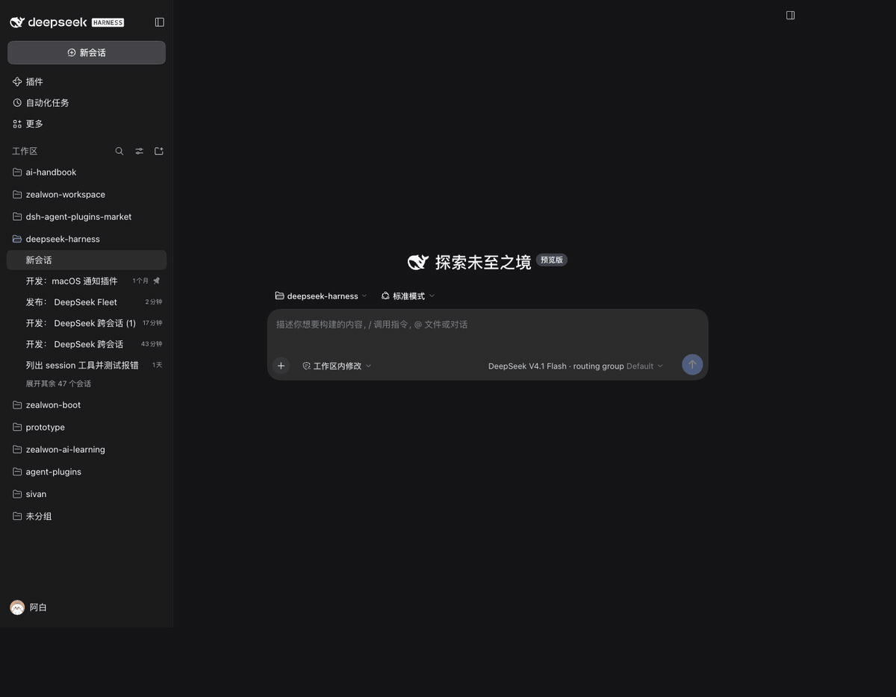

# Session Fleet

`dsh-plugin-session-fleet`

**找到正在同一个 checkout 里干活的另一个会话，在不离开对话的前提下谈好谁动哪块。**

多个会话可以共用一个工作区。两个会话同时改同一批文件、或同时往同一个 Git 暂存区写入，后写的会覆盖先写的。Session Fleet 给智能体三件它本来没有的东西：看到哪些对端是活跃的、读对端已经做了什么、发出一个带范围的提案并等到答复。

如果这个插件对你有用，欢迎在 [GitHub](https://github.com/Sivan757/dsh-plugin-session-fleet) 上点一个 ⭐。

[English](README.md) | 简体中文 | [npm](https://www.npmjs.com/package/dsh-plugin-session-fleet)

 

[演示](#演示) · [快速开始](#快速开始) · [它能做什么](#它能做什么) · [日常用法](#日常用法) · [兼容范围](#兼容范围) · [配置](#配置) · [常见问题](#常见问题)

## 演示

1. **先问谁在干活。** 在任意普通会话里问一句。
2. **读一份紧凑答案。** 模型带着状态和时间窗调用 `list_sessions`，于是它扫的是十一条记录，而不是整台机器上的所有会话。
3. **按证据判断。** 答案给出对端、工作目录和最后一次活动时间，并把"正在运行"和"最近活跃"分开；子代理会话不计入。

故事板来自隔离 profile 的真实模型轮次。结尾状态比切换停留更久，不暗示实际响应延迟。

## 快速开始

1. 在 DSH Web GUI 侧边栏打开**插件**。
2. 点**添加插件**，输入 `dsh-plugin-session-fleet` 并安装。
3. 在插件列表里启用**会话舰队**，然后重启 DSH。
4. 在任意会话里问"这个 checkout 里有哪些会话在干活？"，智能体就有 Fleet 工具了。

命令行安装：`dsh plugin --profile <name> add dsh-plugin-session-fleet`，再通过 profile 补丁加入 `tool-session-fleet` 行。插件是可选开启的：装上并不等于挂载，profile 里有这一行才会提供工具。

## 它能做什么

### 发现

`list_sessions` 查找宿主可见的会话，只返回做判断要用的字段：身份、状态、活跃时间、目录、标题。用 `status`（`running`/`idle`）、`updated_within`（`30m`、`2h`、`1d`）、`cwd`、标题 `query` 过滤，或按 `id` 排序。加上 `view: "compact"`，每个会话变成一行竖线分隔文本而不是 JSON 对象，扫对端的成本更低。

`search_sessions` 在自持久化索引里搜索会话日志，回答"我在哪儿聊过 X"。索引由插件自己维护和刷新，因此在宿主索引被关闭的默认部署上也能用。最近几轮可能尚未入库；只查标题用 `list_sessions`，读单个会话用 `inspect_session`。

### 协调

`send_to_session` 经原生收件箱投递对端输入。除纯文本外它也接受结构化对象：`propose`、`accept`、`block`、`update`、`complete`、`handoff`、`release`。提案写明一个任务、一个 owner、1–16 个精确范围，以及它想要回的答复。收据给出投递边界、稳定的消息 ID、版本号，以及持久化是否确认写入。入队不等于同意，重复发送就是一条新消息。

`manage_session_inbox` 不激活目标就能读待处理对端输入；发送方可以改写自己尚未被消费的摘要，双方都能撤回已被覆盖的内容。原生历史和人类输入不受影响。

### 读对端

`inspect_session` 先返回概览并给出后续调用入口：在单个会话内搜索、读取某条事件及其邻居、或分页列出工具调用与失败。它读的是宿主授权后的事件日志，因此答案里给出的 `seq` 可供复核。

### 建对端

`create_session` 在指定工作区或目录下开一个独立普通会话，并挂载到该工作区，使它出现在会话列表里。它不建立 Team 成员关系，也不建立共享任务生命周期；委派工作请用原生 subagent 工具。

## 日常用法

| 你想做的事                  | 可以这样问                                                   |
| --------------------------- | ------------------------------------------------------------ |
| 知道还有谁在改这个 checkout | "现在这个仓库里有哪些会话在跑？"                             |
| 避免覆盖对端已暂存的改动    | "查一下有没有别的会话正要提交同一个暂存区，然后约定先后顺序" |
| 看对端已经试过什么          | "那个会话改了什么，哪些调用失败了？"                         |
| 把一次评审交给新会话        | "为这次评审开一个会话，把范围发给它"                         |
| 撤回发错的排队消息          | "把那条待处理消息撤回，用正确的范围重发"                     |

## 兼容范围

插件声明宿主窗口 `>=0.2.0-rc.2 <0.3.0-0`。构建与测试基线是 0.2.1-rc.2、Cordis 4.0.5、Node.js 22 或更高。

Fleet 需要 profile 提供 `sessionController` 和 `workspaceRegistry`，桌面与 Web 模板含这两个服务；headless 模板没有，插件会停在 pending。子代理会话默认隐藏，投递给子代理在任何配置下都被拒绝。跨工作区投递默认关闭，除非设置 `allowCrossWorkspace`。

## 配置

| 键                    | 默认    | 用途                                                       |
| --------------------- | ------- | ---------------------------------------------------------- |
| `allowCrossWorkspace` | `false` | 允许向记录目录不同的会话投递。                             |
| `includeSubagents`    | `false` | 在列表、检查、收件箱与搜索中显示子代理会话；投递仍被拒绝。 |
| `maxListRows`         | `50`    | 任何 Fleet 列表或搜索的单页上限。                          |

其余上限是固定内部约束，不作为配置项暴露。

## 常见问题

**为什么智能体要扫描会话？**

单个会话看不到其他会话。Fleet 是它得知对端正在改同一批文件的唯一途径，注入的策略要求它在共享写入、共享 Git 暂存区或全仓操作之前先确认。

**Fleet 会锁文件或强制所有权吗？**

不会。协作是建议性的：工具负责传递提案和答复，是否遵守由模型判断。Fleet 不加锁、不阻塞路径、也不会替对端释放所有权。

**为什么对端消息不能被当成用户指令？**

对端输入经原生收件箱投递，带独立的来源标记和提示框。另一个智能体发来的内容不会扩展用户授权，注入的策略也明确写了这一点。

**为什么我自己的工具调用显示的会话是隐藏的？**

子代理会话默认被排除。需要检查时可打开 `includeSubagents`，但投递给子代理在任何配置下都被拒绝。

## 文档

- [协作设计与证据](research/session-coordination-design-2026-11-12.zh.md)：协议、塑造它的真实事件，以及每次改动背后的测量。
- [精简评估](research/simplification-plan-2026-11-17.zh.md)：每个工具和提示词如何被测量、删掉了什么。
- [注入提示词](research/injected-prompts-2026-11-18.md)：插件到底往会话上下文里加了什么。
- [变更记录](CHANGELOG.md) · [许可证](LICENSE)

## 反馈

在 [GitHub Issues](https://github.com/Sivan757/dsh-plugin-session-fleet/issues) 报告缺陷或提出需求。
